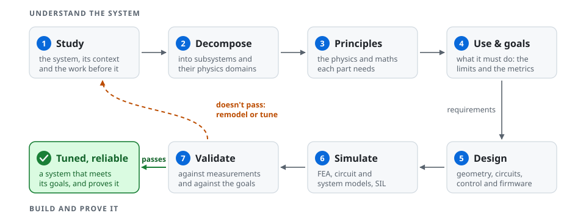
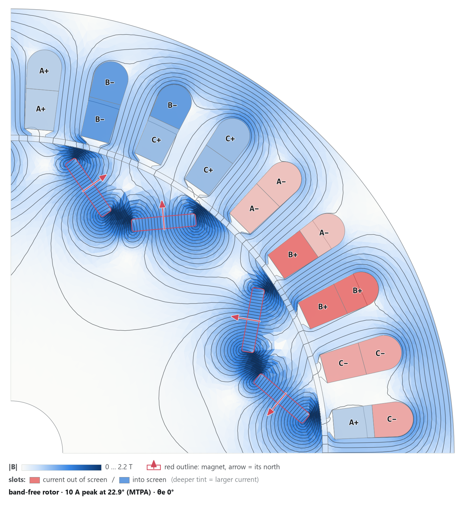

# Vasileios Gkionis

**Final-year Electrical & Electronics Engineering student · University of West Attica, Athens**

I design electric motors and embedded hardware. I model and simulate a system before I build it, and check the model against measurements after.

  <picture>
    <source media="(prefers-color-scheme: dark)" srcset="assets/pipeline-dark.svg">
    
  </picture>

## Motor design: IPM synRM

[**IPM-synRM**](https://github.com/Bill-Gkionis/IPM-synRM) is a 36-slot, 8-pole permanent-magnet-assisted synchronous reluctance motor, with two N45 magnets per pole in a V and M-19 laminations. It is designed around a fixed envelope and a given set of magnets: the question is the best motor that fits them.

  
   
  The band-free rotor in FEMM at 10 A on its MTPA angle: flux lines, flux density, and the phase sequence of the double-layer winding.

- **FEA:** 2D magnetostatics in FEMM, scripted from Python: rotor-position sweeps, flux linkages, Ld and Lq, torque and ripple.
- **Models:** flux-linkage extraction and the Clarke/Park transforms in MATLAB, and a field-oriented-control plant in Simulink.
- **Model accuracy:** at 40 A, the textbook MTPA formula fed the axis inductances FEMM gives at that current picks a current angle of 25°, where the flux maps find 43°. Cross-saturation costs that choice about 10 % of the torque, so the MTPA table comes from the FEA flux maps, not from the formula.
- **Optimization:** a scripted pipeline from Python geometry through FEMM to optimization techniques, including NSGA-II and NSGA-III, and factor evaluation with SALib (in progress).
- **Next:** Elmer, CalculiX and ROSS for the electromagnetic, structural and rotor-dynamic checks, and a flux-map-driven plant in Simulink.

## Experience

**Internship · Roboteq (Nidec Automation)** · July–August 2026

A calorimeter that measures the losses of a 1.5 kW motor-drive inverter directly as heat. At 90–99 % efficiency, the losses (15–200 W) are too small to resolve as electrical power in minus power out.

- A guarded double-jacket chamber: the losses are read from a water loop as ṁ·cp·ΔT, while a servoed guard cancels the heat that would leak through the walls. Target accuracy: ±1 W.
- My part was the electrical, embedded and control side: the thermal model in Simulink and Python, the closed-loop simulation, and the ESP32-S3 firmware on Zephyr RTOS. A mechanical engineer owned the enclosure.

## Other projects

| Project | What it is | Tools |
|---|---|---|
| [Desktop-VR Electronics Lab](https://github.com/Bill-Gkionis/VR-thesis) · diploma thesis | A virtual lab bench where students practise with an oscilloscope, a function generator and a bench PSU on a common-emitter amplifier. It is the technical part of a Ph.D. study on instructional design. | Unity, C#, Blender, Inkscape |
| [RP60 keyboard](https://github.com/Bill-Gkionis/rp60_design) | A 60 % keyboard built end to end: an RP2040 board with USB-C and ESD protection, a 3D-printed case, and [QMK/VIA firmware](https://github.com/Bill-Gkionis/rp60). | Altium Designer, QMK |
| [Balancing structure](https://github.com/Bill-Gkionis/balancing-structure) | A 3D-printed inverted-triangle structure for trying out a hybrid fuzzy + PID controller. | SOLIDWORKS, 3D printing |
| [Pi 5 VISA server](https://github.com/Bill-Gkionis/pi5-visa-server) | A Raspberry Pi 5 that puts USB lab instruments on the network: a Flask API forwards VISA/SCPI commands to them. | Python, PyVISA, Flask |

## How I work

- **Model, simulate, build, measure,** and go back to the model when the data disagrees.
- **Every number has a source:** a script, a datasheet, a standard or a measurement. Values from course notes get checked against manufacturers' data before I use them.
- **Decisions are hypotheses.** I write each one down, test it, and reverse it when the results say so.
- **Scripted and documented.** Analyses run from Python and MATLAB scripts and are written up so that someone else can rerun them.
- Theory is about a third of a project. Simulation and validation are the rest.

## Skills

| Area | Tools |
|---|---|
| **Modeling & simulation** | MATLAB, Simulink, Simscape Electrical · FEMM (2D FEA) · LTspice |
| **Programming** | C · Python · MATLAB · C# |
| **Embedded** | RP2040 · ESP32-S3 · Zephyr RTOS (learning) · STM32 HAL · Zynq-7000 on PYNQ-Z2 (basic VHDL) |
| **Hardware design** | Altium Designer, KiCad · SOLIDWORKS, Onshape · 3D printing (Bambu Lab X1C) |
| **Lab** | Oscilloscope, signal generator, bench PSU · SCPI automation with PyVISA · soldering and SMD rework |
| **Workflow** | Git · Linux (Debian) · VS Code |
| **Languages** | Greek (native) · English (fluent) |

## Certifications

| Certification | Issuer | Date | Proof |
|---|---|---|---|
| Certified SOLIDWORKS Associate (CSWA), Mechanical Design | Dassault Systèmes | April 2024 | [Verify](https://cv.virtualtester.com/qr/?b=SLDWRKS&i=C-TA24JBW89H) · [PDF](certificates/SOLIDWORKS-CSWA-Mechanical-Design.pdf) |
| Altium Designer Essentials | Altium | December 2023 | [Verify](https://certificates.altium.com/?Id=e602e51e-ffd3-e72a-5af6-9a35f4774852) · [PDF](certificates/Altium-Designer-Essentials.pdf) |
| Motor Modeling with Simscape Electrical | MathWorks | March 2026 | [PDF](certificates/MathWorks-Motor-Modeling-with-Simscape-Electrical.pdf) |
| MATLAB Skills for Simulink Modeling (learning path, 5 courses) | MathWorks | April 2026 | [PDF](certificates/MathWorks-MATLAB-Skills-for-Simulink-Modeling.pdf) |
| Build MATLAB Proficiency (learning path, 8 courses) | MathWorks | April 2026 | [PDF](certificates/MathWorks-Build-MATLAB-Proficiency.pdf) |

Also completed: the MathWorks Onramps for Power Electronics Simulation, Simscape, Circuit Simulation and Signal Processing.

## Contact

grader_encore6t@icloud.com · CV on request
